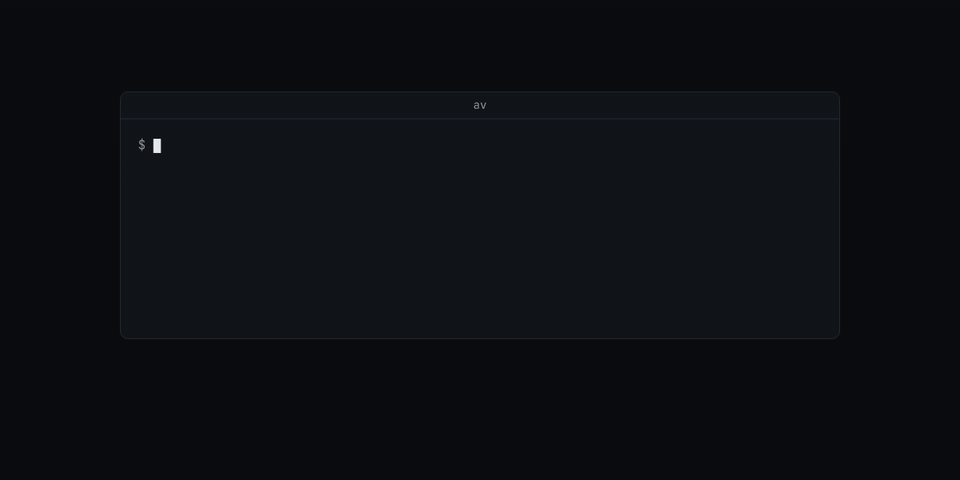

# av

*Feed it a song and it grows a world. Kicks become tremors, drops become weather.*

av runs the [nw_wrld](https://github.com/aagentah/nw_wrld) audiovisual dashboard and projector in a browser and adds Genome World, a 3D scene driven by an offline analysis of the track that is playing.



av is a modified version of **nw_wrld** by the nw_wrld Contributors, licensed under GPL-3.0. The complete upstream tree at revision `a660a229d2413c48c3ca03bacf41421ff93e7836` (`0.7.0-beta`) is in `app/`. [`NOTICE`](NOTICE) lists every upstream file av changed or added. [`app/UPSTREAM.md`](app/UPSTREAM.md) describes the browser port.

## Why

A visual that follows the live signal level changes on every frame and cannot know where the next drop is. Genome World reads a precomputed analysis of the track instead: sections, beats and downbeats, six separated stems, onsets and band energy. The scene holds a pose through each eight-downbeat phrase and morphs only on bars and section boundaries. Drum events change the light, and the bass adds a bounded local bend. Playback and visuals share one Web Audio clock, so a seek or a pause gives the same picture every time.

nw_wrld itself is an Electron app. av replaces Electron's IPC, `BrowserView` and protocol handlers with browser messaging, an iframe and a local workspace server, so the dashboard and projector run in one browser tab.

## Install

Requirements:

- Node.js 20 or later and npm. Tested with Node.js 24.14.1 and npm 11.11.0.
- A browser with WebGL 2 and Web Audio.
- To analyze new tracks, a [Modal](https://modal.com) account and the `modal` CLI. Tracks that already have a genome play without it.
- To build the analyzer's waveform engine locally, Rust. Tested with Rust 1.94.1.
- To record visual tests, `ffmpeg`, `ffprobe` and a Chrome with remote debugging on port 9334.

```sh
git clone <this repository> av
cd av
npm ci
```

`npm ci` installs the root packages: `three` 0.159.0, esbuild, TypeScript and Playwright. The first `npm start` or `npm run build` also runs `npm ci` in `app/` (193 packages, 34 s on the test machine).

## Quick start

```sh
npm start
```

On the test machine, 3 November 2026:

```text
> av-genome-world@0.3.0 start
> node scripts/start-web.mjs dev

[watch] build finished, watching for changes...

  VITE v6.4.1  ready in 2279 ms

  ➜  Local:   http://127.0.0.1:5177/
```

Open `http://127.0.0.1:5177/`. The nw_wrld dashboard opens beside its projector, with the Genome World track selected. In the projector, choose an audio file to analyze and play it. To play without the analyzer, give it the audio file and a v3 genome JSON for that file.

The dashboard's four channels play, pause, hide the projector controls and show them. **Open projector** moves the visual to its own tab. The track, position, view and feel settings move with it and come back when the tab closes. If the browser blocks autoplay after the move, press **Play** in the projector.

The other commands:

| Command | What it does |
| --- | --- |
| `npm run dev` | The same as `npm start`: the dev server on port 5177, with the Genome World module rebuilt on change. |
| `npm run build` | Builds the Genome World module into `nw/project/modules/GenomeWorld.js` and the web app into `app/dist/`. 73 s on the test machine, including the first `app/` install. |
| `npm run preview` | Serves the built app and the workspace API on `http://127.0.0.1:4173`. |
| `npm test` | Runs the player, module and web-host tests. 59 tests passed on the test machine. |
| `npm run check` | Type-checks `nw/` with `tsc`. |
| `npm run nw:setup`, `npm run nw:start` | The optional Electron route. See [`nw/README.md`](nw/README.md). |
| `npm run legacy:player` | The old standalone player in `player/`. It is not the main app. |
| `npm run test:visual -- --iteration <name>` | Records reference passages through Chrome for side-by-side review at `/reviews/`. |

## How it works


`MusicSession` (`player/src/session.ts`) owns the audio clock, the analysis request and the current performance. It hashes the audio with SHA-256 and looks the hash up in the browser's IndexedDB library (`player/src/library.ts`). On a miss, `player/src/analyzer.ts` posts the file to `$VITE_GENOME_URL/analyze` and stores the returned genome with the audio. The genome must carry the same `track_sha256`, or the session rejects it.

The analyzer is `genome/modal_app.py`, a Modal app on a T4 GPU. It runs EDMFormer for sections, Beat This! for beats and downbeats, HTDemucs (`htdemucs_6s`) for six stems, and the Rust waveform engine in `genome/engine/` on the mix and on each stem. It caches results by the file's SHA-256. [`genome/SCHEMA.md`](genome/SCHEMA.md) describes the output.

`Conductor` (`player/src/conductor.ts`) reads the genome as a score with lookahead. It samples every output at absolute audio time. `MusicWorld` (`player/src/world/MusicWorld.ts`) draws the scene, and `nw/src/GenomeWorld.ts` hosts it as an nw_wrld module. The module build injects nw_wrld's own Three.js r159, so the scene shares one Three.js copy with the host.

The module exposes these methods to the nw_wrld dashboard: `loadTrack({ audio, genome })`, `playTrack`, `pauseTrack`, `seekTrack({ seconds })`, `setFeel({ punch, bass, detail, glow })`, `setView({ azimuth, elevation, distance })` and `showControls({ visible })`. Asset paths are relative to the workspace's `assets/` directory.

### Run the waveform engine locally

The waveform engine needs no GPU. It decodes any audio format through Symphonia, resamples to 44.1 kHz and writes envelopes, five bands (`sub`, `low`, `mid`, `high`, `air`), chroma, onsets, wobble and tension as JSON. The optional third argument writes the 44.1 kHz WAV that Beat This! reads.

```sh
cd genome/engine
cargo build --release --locked
./target/release/genome-engine track.wav track.json track.44k.wav
```

The build took 3 min 7 s on the test machine. On a 16 s test signal of 55 Hz kicks at 128 BPM, made with `ffmpeg`, the engine printed this in 0.49 s:

```text
genome-engine: 16.0s @44100Hz -> 34 onsets, written to kick-128bpm.json
```

### Deploy the analyzer

```sh
cd genome
modal run modal_app.py::download_weights   # downloads the model weights into the genome-weights Volume
modal deploy modal_app.py
```

Modal prints the URL of the `web` endpoint. It serves `POST /analyze` (multipart field `file`) and `GET /health`. Set `VITE_GENOME_URL` to that URL without `/analyze`, then start or build av. To analyze a file from the command line:

```sh
python3 genome/scripts/analyze.py track.m4a --url <web endpoint URL>/analyze
```

It writes `track.genome.json` next to the input.

### Follow a dj-organizer library

`app/web/dj-bridge.ts` proxies a local dj-organizer server. `GET /api/dj/tracks` lists its library and `GET /api/dj/audio/:id` streams a track. dj-organizer's player posts to `POST /api/dj/now-playing`, and the visualizer follows it over server-sent events at `GET /api/dj/now-playing/events`. The bridge only reads from the library. `http://127.0.0.1:5177/visualizer.html?track=<id>` opens the scene full screen, without the nw_wrld shell. Without dj-organizer running, `/api/dj/tracks` answers `503` with `{"error":"DJ library (dj-organizer on :8765) is not running"}`.

## Configuration

av reads environment variables. Set them in the shell that runs the command.

| Variable | Default | Read by | What it does |
| --- | --- | --- | --- |
| `VITE_GENOME_URL` | empty | `npm start`, `npm run build`, `npm run nw:setup` | The base URL of the deployed analyzer. The client posts to `$VITE_GENOME_URL/analyze`. When it is empty, a new track fails with `no analyzer configured: set VITE_GENOME_URL`. `nw:setup` also adds its origin to the desktop sandbox's `connect-src`. |
| `NW_WRLD_PROJECT_DIR` | `nw/project` | the web server, `nw:setup`, `nw:start` | The workspace: dashboard configuration, module edits and `assets/`. Setup copies missing defaults from `nw/template/` and never overwrites existing JSON. |
| `NW_WRLD_USER_DATA_DIR` | `.runtime/profile` | `nw:start` | The Electron profile of the optional desktop route. |
| `DJ_ORGANIZER_URL` | `http://127.0.0.1:8765` | the web server | The dj-organizer server behind `/api/dj/`. |
| `TRACKS_DIR` | `~/Music/Tracks` | `npm run legacy:player` | The folder the legacy player lists at `/api/tracks`. |
| `CDP` | `http://localhost:9334` | `scripts/recorder-window.mjs` | The Chrome remote debugging endpoint for visual recordings. |
| `GENOME_API_KEY` | unset | the Modal analyzer | When set in the container, `POST /analyze` requires a matching `x-api-key` header. |

The workspace in `nw/project/` and the recordings in `artifacts/visual-tests/` are ignored by Git.

## Limits

- **The analyzer is non-commercial.** The MuQ weights it downloads are licensed CC BY-NC 4.0, so a deployment of `genome/` may not be used commercially. EDMFormer's checkpoint is CC BY 4.0 and needs attribution. No weights ship in this repository. [`genome/MODELS.md`](genome/MODELS.md) lists every model and its license.
- No analyzer endpoint is built in. Without `VITE_GENOME_URL`, only tracks already in the library or supplied with their genome play.
- The browser client never sends `x-api-key`, and `modal_app.py` attaches no Modal secret. A deployed analyzer is open to anyone with its URL unless you change both.
- `dj-bridge.ts` accepts `now-playing` posts only from `localhost:8765` and `127.0.0.1:8765`, whatever `DJ_ORGANIZER_URL` says.
- The app needs its local server for the workspace API. A static host cannot serve the build.
- The web adapter has no native UDP OSC. Browser MIDI works after **Enable MIDI**.
- The analyzer feeds HTDemucs a mono decode copied to two channels, so separation gets no stereo cues.
- Genome World is an artistic mapping of music onto standing-wave patterns. It is not a physical cymatics simulation.
- Not run for this README: the Electron route (`nw:setup`, `nw:start`), the legacy player, `test:visual`, and a Modal deploy.

## License

GPL-3.0-or-later. See [LICENSE](LICENSE) and [NOTICE](NOTICE). nw_wrld is GPL-3.0, Copyright (C) 2025 nw_wrld Contributors; its license is in [`app/LICENSE`](app/LICENSE). The analyzer's models carry their own licenses, listed in [`genome/MODELS.md`](genome/MODELS.md).
